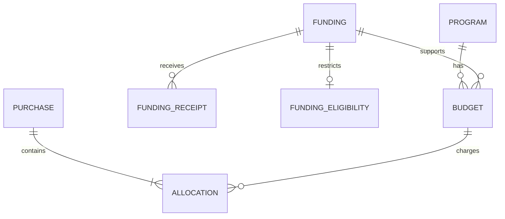

# Architecture and requirements

The React staff interface calls same-origin FastAPI routes through Caddy. FastAPI uses Psycopg and parameterized PostgreSQL queries. Named staff accounts use salted scrypt credentials, administrator or staff roles and opaque server-side sessions. Every audit event records the signed-in account. Schema changes run as numbered, forward-only migrations (`backend/app/migrations.py`); version 1 is the original idempotent `schema.sql`. Business dates use `ASUFC_TIMEZONE` (default `America/Halifax`). The development staff profile publishes only a loopback gateway and keeps its PostgreSQL data in a dedicated Compose project. The production profile requires HTTPS and secure cookies. The public Pages build uses a fictional in-memory transport.

Funding receipts distinguish confirmed funds from expected awards. Cash and purchasing credits have separate balances. A budget reserves confirmed funding for a program. Purchase allocations must add up to the purchase total in integer cents. The server checks the program, supplier, purchase type, remaining balances, expiry, and academic year for each allocation. Allocation suggestions apply the same eligibility checks and require staff confirmation.

A source can list multiple eligible values per category. Each nonempty list must match the purchase. Existing single-value restrictions are read when a source has no edited list. The row lock on the source coordinates spending, budget changes, and edits. Grant exceptions that depend on individual items or reporting evidence require staff review. Release an unused incompatible budget to zero before removing that program from the source's rules. Active transfers preserve the source's rules and block changes that would diverge from them.

Academic years isolate funding and budgets. Semester presets and report date filters support reporting within the selected financial year. Corrections link a replacement to the original, and voids preserve history while restoring capacity. Excel import uses the same purchase validation. Reconciliation compares internal records, and bank settlement is a separate staff process.

The desktop launcher serves the production staff interface and PostgreSQL on loopback. Starter files are applied atomically to a new ledger. A pending purchase becomes confirmed only when the existing allocation checks pass in the same transaction that links it back to its intake record. Private receipt binaries and metadata live with the ledger. The desktop backup encrypts a snapshot of these records and authenticates each part before restoring it into a fresh local database.

The eligibility schema is additive. A database backup includes the effective rules and their audit history. If reverting the app from a version with list-based rules, pause writes and verify that the restored version enforces the current rules before reopening staff access. Older servers only interpret the legacy fields.

Formal financial dates, approved grant terms, staff account handover, receipt retention and external AI approval remain stakeholder decisions.

## Ledger records added after 0.4

- **Refunds** (`purchase_refund`, `purchase_refund_allocation`) reduce the spending on each budget that paid for a purchase. The `active_allocation` view subtracts them, so balances, reports and suggestions use net spending. A purchase with refunds is voided rather than corrected.
- **Returns to funders** (`funding_return`) reduce a source's capacity in `funding_capacity`. Staff release unused budget allocations first.
- **Pledge status** (`funding.commitment`) separates committed expected funding from unconfirmed pledges and estimates.
- **Bank balances** (`bank_statement`) are compared with ledger cash: dated and undated cash receipts less cash spending, refunds and returns, across all academic years. Carry-forward transfers and purchasing credits are excluded. Pending purchases and undated receipts are reported as known differences. This is a balance comparison, not transaction-level bank matching.
- **Name catalog** (`catalog_entry`) stores one spelling per supplier and purchase type, matched without regard to case or spacing. Purchases, pending purchases and spending rules store the catalog spelling. Merges rename every use in one audited transaction.
- **Late entry**: eligibility is judged on the purchase date. A purchase dated on or before a grant's expiry can be recorded after it, with a recorded reason. Imports use a fixed historical reason.
- **Tracker import** reads the staff budget tracker's funding and spending sections into a starter draft. Spending becomes pending purchases because the tracker does not record the paying source.
